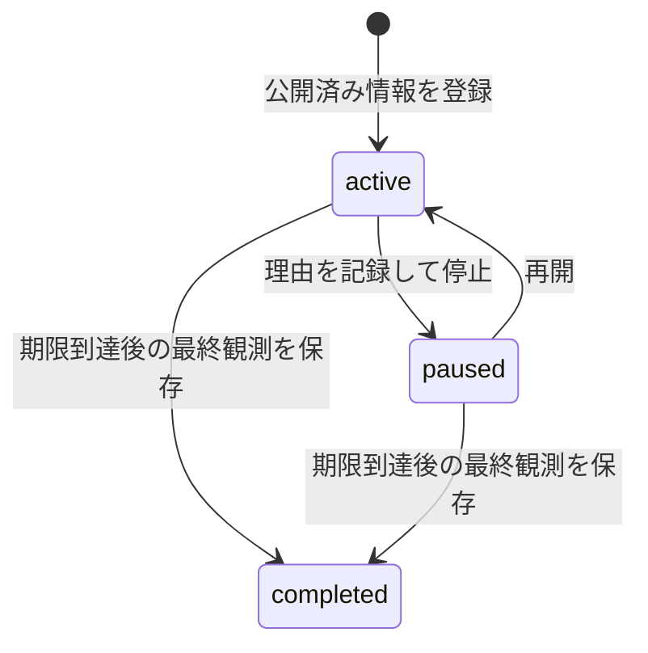

# 設計と検証の読みどころ

AIを使う記事制作の手順をテンプレート化し、人が確認した公開・観測情報をPythonで管理する例です。CLIによる投稿の自動化や、売上・閲覧数の自動取得は実装していません。

## コードを読む順番

1. [テンプレート](../templates): 調査・構成・下書き・公開導線の分担。
2. [Project](../scripts/note_workflow.py): 入力検証、台帳更新、編集前の履歴保存。
3. [ライフサイクルテスト](../tests/test_note_workflow.py): 90日期限、一時停止、最終記録、不正入力時の保持。
4. [通信しないデモ](../examples/run_demo.py): 架空データで `active → paused → completed` を試す経路。



未知の数値をゼロとして集計すると意味が変わるため、未取得はnull、実測したゼロは0として扱います。期限では最終観測を先に保存してから台帳を完了へ更新し、途中で更新に失敗した場合に元の記録を確認できる順序にしています。同時書き込みのロックはなく、変更コマンドの並列実行には対応していません。

## 通信しないデモ

```sh
python examples/run_demo.py
python examples/run_demo.py --out demo-records
python -B -m unittest discover -s tests -v
```

デモは一時ディレクトリを使い、実際の制作資料・公開台帳を変更しません。`--out` は存在しない保存先だけを受け付けます。2026年11月8〜9日、Windows / Python 3.13.1で3テストとデモが成功しました。

架空データでは2024年1月31日の登録から90日後の2024年4月30日を期限とし、7日目の観測、停止、期限到達、最終記録、completedを確認します。例のURLや数値は実在の記事・利用実績ではなく、外部サイトへアクセスしません。

共有用ソースにはコード・テスト・汎用テンプレート・このデモを含め、実際の記事本文、制作時の会話、公開設定、台帳、観測値は含めない構成を推奨します。AI利用で削減できた時間や売上の効果は計測していません。
